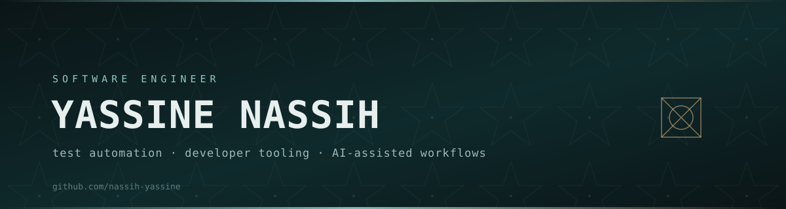

**`test automation · developer tooling · AI-assisted workflows`**

I turn flaky releases into boring ones — with the suites, the frameworks, and the agent plumbing to prove it.

 

---

### What I do

| | |
|---|---|
| **🤖 Automation that holds** | Playwright & Selenium suites across UI and API, wired into CI so a release is no longer a dice roll. |
| **🧠 Agents with guardrails** | Multi-agent workflows, custom rules and memory banks, MCP servers that let agents act on databases, Jira and browsers. |
| **🛠️ Tooling that deletes work** | Python, Go and shell utilities that remove the manual, repeatable parts of QA and DevOps. |

### Languages

### Frameworks & tools

### Featured

<table>
<tr>
<td width="8%"><h3>📿</h3></td>
<td>
<b><a href="https://github.com/nassih-yassine/Addan">Addan</a></b> — offline-first Android prayer app. Local prayer times, one alarm, no telemetry SDKs.
 <code>Kotlin</code> <code>Jetpack Compose</code> <code>Gradle</code>
</td>
</tr>
</table>

---

No badge spam. No employer logos. One screen, or it doesn't ship.

